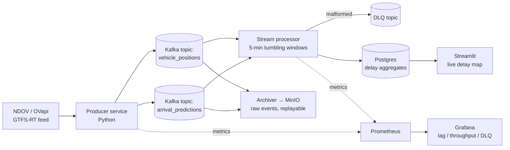

# PRD — Real-time NL OV Streaming Pipeline

**Status:** Draft
**Owner:** Ruud Juffermans
**Created:** 2026-07-13
**Target timeline:** 3 weeks full-time, weeks 8–10 of the portfolio plan (built *after* Project 3; fine to build while already applying)
**Source spec:** `zzp/portfolio-projects.md` — Project 2

---

## 1. Overview

### 1.1 One-liner

Streaming pipeline that consumes real-time Dutch public transport vehicle positions and
arrival predictions (NDOV/OVapi GTFS-realtime feed) through Kafka (Redpanda), computes
rolling delay aggregates per line and station in 5-minute tumbling windows, and serves
them in a live Streamlit dashboard with a map of current delays.

### 1.2 Why this project

- Streaming/Kafka is the most common "nice-to-have that becomes a must-have" in NL job
  specs — bol, ING, Ahold, and KLM all run Kafka.
- A *working* streaming project puts a career-switcher ahead of most competitors, whose
  portfolios are batch-only.
- It is the **differentiator** project: Projects 1 + 3 open doors; this one closes them.

### 1.3 Golden rule

The repo must read as **production work, not a tutorial**: tests, CI, dead-letter
handling, observability, and a README that explains throughput, lag handling, and
schema evolution — the questions an interviewer actually asks about streaming.

---

## 2. Goals & Non-Goals

### 2.1 Goals

1. A producer service consuming the NDOV/OVapi real-time feed and publishing to Kafka
   topics with a defined, versioned schema.
2. A stream processor computing rolling delay aggregates per line/station in 5-minute
   tumbling windows.
3. Aggregates in Postgres; raw events archived to object storage for replay.
4. A live Streamlit dashboard: map of current delays + worst lines/stations tables.
5. Dead-letter queue for malformed messages, with a documented reprocessing path.
6. Consumer-lag and throughput metrics in Grafana via Prometheus.
7. One-command startup: `docker compose up` (wrapped in `make up`) brings up the
   entire stack.
8. Stack survives a **24-hour continuous run** without intervention.
9. README documenting throughput numbers, lag-handling strategy, and schema
   evolution approach; 2-minute screen recording of the live dashboard embedded.

### 2.2 Non-Goals

- Cloud deployment — this project is deliberately all-local (docker-compose); Azure is
  covered by Projects 1 and 3.
- Exactly-once *delivery* guarantees end-to-end — instead, document the idempotency
  reasoning that makes at-least-once safe (a deliberate, interview-ready trade-off).
- Historical analytics / batch backfill of transit data (raw archive enables it later,
  but building it is out of scope).
- Multi-region, HA, or Kafka cluster tuning beyond a single-broker Redpanda.
- Covering every OV modality perfectly — trains + a bounded set of bus operators is enough.

---

## 3. Users & Use Cases

| Persona | What they want |
|---|---|
| **Prospective client / recruiter** | Proof of event-driven design skills: topics, windows, DLQs, lag — with numbers, not buzzwords. |
| **Dashboard consumer (simulated stakeholder)** | "Which lines/stations have delays *right now*, and how bad is it?" |

Key questions the pipeline must answer live:

1. What is the average and P90 delay per line over the last 5 minutes?
2. Which stations currently have the worst average departure delay?
3. Where are vehicles right now, colored by delay severity (map)?
4. Ops: what is the consumer lag, throughput (msg/s), and DLQ rate right now?

---

## 4. Data Source

| Source | Data | Volume | Auth | Notes |
|---|---|---|---|---|
| **NDOV loket / OVapi** | Real-time vehicle positions & arrival predictions for Dutch trains and buses (GTFS-RT / KV6 over ZeroMQ, or OVapi HTTP endpoints) | High — thousands of msgs/min nationwide | Free (NDOV requires a simple registration; OVapi is open) | Genuinely real-time; choose primary protocol in week 1 (see Open Questions) |
| **Static GTFS (NDOV)** | Route, stop, and trip reference data for enriching events (line names, stop coordinates) | Daily file | Free | Loaded at startup into Postgres reference tables; refreshed daily by a sidecar job |

**Event contract:** every raw message is archived unmodified (object storage, partitioned
by topic/date/hour) before any parsing — the replay source of truth. Parsed events carry:
vehicle id, trip id, line, stop, timestamp (UTC), delay seconds, position (lat/lon),
schema version.

---

## 5. Architecture



### 5.1 Components

| Component | Technology | Decision rationale |
|---|---|---|
| Broker | **Redpanda** (single node, Docker) | Kafka-API-compatible, zero-config, light on a laptop; interviews still count it as "Kafka" |
| Producer | Python service (`confluent-kafka`), consuming GTFS-RT/ZeroMQ | Thin, testable adapter; protobuf/GTFS-RT parsing isolated in one module |
| Stream processing | **Python Kafka consumer first** (manual windowing); PySpark Structured Streaming as a stretch swap | Start with the simplest thing that demonstrates windowing correctly; upgrading to Spark is a documented migration, itself a talking point |
| Aggregate sink | Postgres (Docker) | Ubiquitous, easy for Streamlit to query; upsert per (window, line/station) key makes reprocessing idempotent |
| Raw archive | MinIO (S3-compatible, Docker), JSON-lines per topic/hour | Replayability without cloud cost; same pattern as ADLS in prod |
| DLQ | Dedicated Kafka topic + tiny inspector CLI | Malformed messages are a certainty with public transit feeds; showing the handling path is the differentiator |
| Dashboard | Streamlit + pydeck/folium map, 10s auto-refresh | Lightweight; the point is the pipeline, not the frontend |
| Observability | Prometheus + Grafana (provisioned dashboards in repo) | Consumer lag, msg/s, DLQ rate, window processing time |
| Ops | docker-compose for everything; `make up / down / logs / replay` | One-command startup is the Definition of Done |

### 5.2 Stream processing design

- **Windows:** 5-minute tumbling windows keyed by line and by station, computing
  count, mean delay, P90 delay, max delay.
- **Late events:** allow a fixed lateness (e.g. 2 minutes) before window finalization;
  later-than-that events are counted in a `late_events` metric and dropped —
  documented trade-off.
- **Idempotency / at-least-once reasoning:** consumer commits offsets *after* the
  windowed upsert into Postgres; upsert key = (window_start, dimension, dimension_id),
  so redelivery cannot double-count a finalized window. This reasoning goes in the
  README verbatim — it is a standard interview question.
- **Schema evolution:** events carry `schema_version`; parser supports current and
  previous version; approach documented in README (what changes are
  backward-compatible, how a v2 rollout would work).
- **DLQ policy:** any message failing parse/validation goes to `dlq.<source_topic>`
  with error metadata headers; DLQ depth is a Grafana panel; `make replay-dlq`
  reprocesses after a parser fix.

### 5.3 Repository layout

```
nl-ov-streaming-pipeline/
├── PRD.md
├── README.md                  # throughput numbers, lag & schema-evolution story
├── Makefile                   # up / down / test / logs / replay-dlq
├── docker-compose.yml         # redpanda, postgres, minio, prometheus, grafana, services
├── producer/
│   ├── src/                   # feed client, GTFS-RT parsing, Kafka publisher
│   └── tests/                 # pytest on parsing with recorded feed fixtures
├── processor/
│   ├── src/                   # windowing, aggregation, DLQ, sink
│   └── tests/                 # window logic tests incl. late/duplicate events
├── archiver/                  # raw events → MinIO
├── dashboard/                 # Streamlit app
├── observability/             # prometheus.yml, provisioned Grafana dashboards
├── gtfs-static/               # loader for reference data
└── .github/workflows/ci.yml   # pytest + lint on PR
```

---

## 6. Requirements

### 6.1 Functional

| ID | Requirement |
|---|---|
| F1 | Producer consumes the NDOV/OVapi real-time feed and publishes to `vehicle_positions` and `arrival_predictions` topics with a versioned schema |
| F2 | Every raw message is archived to MinIO before/independent of processing, partitioned by topic/date/hour, enabling full replay |
| F3 | Processor computes 5-min tumbling-window aggregates (count, mean, P90, max delay) per line and per station |
| F4 | Aggregates upserted into Postgres idempotently (redelivery never double-counts) |
| F5 | Malformed messages land in a DLQ topic with error metadata; `make replay-dlq` reprocesses them |
| F6 | Streamlit dashboard shows a live delay map + worst-lines and worst-stations tables, auto-refreshing |
| F7 | Static GTFS reference data (lines, stops, coordinates) loaded into Postgres and refreshed daily |
| F8 | Prometheus scrapes producer & processor metrics; Grafana ships with provisioned dashboards for consumer lag, throughput, DLQ depth, late-event rate |
| F9 | `make up` starts the full stack from a clean clone (prerequisites: Docker, make, feed credentials in `.env`) |
| F10 | `make replay` re-runs the processor from the MinIO archive over a chosen time range |

### 6.2 Non-functional

| ID | Requirement |
|---|---|
| N1 | Stack survives a 24h continuous run on a laptop without manual intervention |
| N2 | Steady-state consumer lag stays bounded (does not grow monotonically) at nationwide feed volume; actual throughput (msg/s) measured and documented |
| N3 | Unit tests cover parsing, window assignment, late-event handling, and duplicate delivery; no live feed needed in CI (recorded fixtures) |
| N4 | End-to-end latency feed → dashboard ≤ 1 window (≈ 5 min) for finalized aggregates; positions on the map ≤ 30s old |
| N5 | All timestamps UTC internally; local time only in the dashboard |
| N6 | Zero cloud cost — everything runs in docker-compose |
| N7 | Every non-obvious choice recorded in README "Decisions & trade-offs" |

---

## 7. Definition of Done

From the source spec, made testable:

- [ ] `make up` brings up the full stack on a clean clone.
- [ ] Stack completes a **24-hour continuous run**; Grafana screenshot of the run (lag, throughput) in README.
- [ ] Measured throughput documented in README (msg/s in, aggregates/min out).
- [ ] README documents lag-handling strategy and schema-evolution approach.
- [ ] DLQ path demonstrated: a malformed message lands in the DLQ, is visible in Grafana, and is reprocessed via `make replay-dlq`.
- [ ] Duplicate-delivery test proves aggregates are not double-counted.
- [ ] **2-minute screen recording** of the live dashboard embedded in the README.
- [ ] CI (pytest + lint) green; repo public on GitHub with badge.

---

## 8. Milestones

| Week | Deliverable | Exit criteria |
|---|---|---|
| **1 — Ingest & backbone** | Feed access sorted, protocol chosen, docker-compose with Redpanda/Postgres/MinIO, producer publishing parsed events, raw archiver, static GTFS loader | Events visibly flowing into topics and MinIO for ≥ 1 hour; parsing unit-tested against recorded fixtures |
| **2 — Processing & serving** | Windowed processor with DLQ + idempotent Postgres sink, Streamlit dashboard with map, replay command | Correct aggregates verified against a hand-computed fixture window; dashboard live; duplicate/late-event tests green |
| **3 — Ops & polish** | Prometheus + Grafana dashboards, 24h run, throughput measurement, screen recording, README, CI | Full Definition of Done checklist passes |

**Sequencing note:** kick off the 24-hour run at the *start* of week 3 so there is time
for one retry if it falls over.

---

## 9. Risks & Mitigations

| Risk | Likelihood | Mitigation |
|---|---|---|
| NDOV registration/feed access friction | Medium | Register on day 1; OVapi HTTP endpoints as fallback source — same data, simpler access |
| Feed protocol complexity (ZeroMQ + gzipped XML KV6 vs GTFS-RT protobuf) | High | Timebox protocol choice to 2 days; isolate in one adapter module; recorded fixtures make the rest of the system independent of the choice |
| Feed volume overwhelms a laptop | Medium | Filter to trains + selected operators via config; document the filter and the measured full-feed rate |
| Overnight feed lull breaks the 24h-run narrative (few vehicles 01:00–05:00) | High | Expected behavior — annotate the Grafana screenshot rather than "fixing" it |
| Windowing correctness bugs (late/duplicate events) | Medium | Deterministic unit tests with synthetic event sequences before touching live data |
| Scope creep toward Spark/exactly-once/cloud | High | Non-goals are binding; PySpark swap only if weeks 1–2 finish early |
| Streamlit map performance with many vehicles | Low | Cap rendered vehicles; aggregate view is the primary artifact |

---

## 10. Open Questions

Track answers in the README decisions log once resolved.

1. Primary feed: NDOV KV6/ZeroMQ (richer, gnarlier) or OVapi GTFS-RT/HTTP (simpler)?
   Timebox to 2 days in week 1.
2. Scope filter: nationwide all-modality, or trains + 2–3 bus operators? (Decide from
   measured volume on day 3.)
3. Python consumer only, or swap in Spark Structured Streaming in week 3 if ahead of
   schedule?
4. Delay definition: use feed-provided delay field vs. computing predicted − scheduled?
   (Depends on chosen feed's fields.)
5. Keep 24h of raw archive in the repo as a sample dataset for reviewers, or just
   fixtures?

---

## 11. Skills demonstrated (for CV/site copy)

Kafka (Redpanda) · event-driven design · stream windowing · at-least-once/idempotency
reasoning · dead-letter queues · schema evolution · Python · Postgres · Docker ·
Prometheus/Grafana observability · Streamlit
