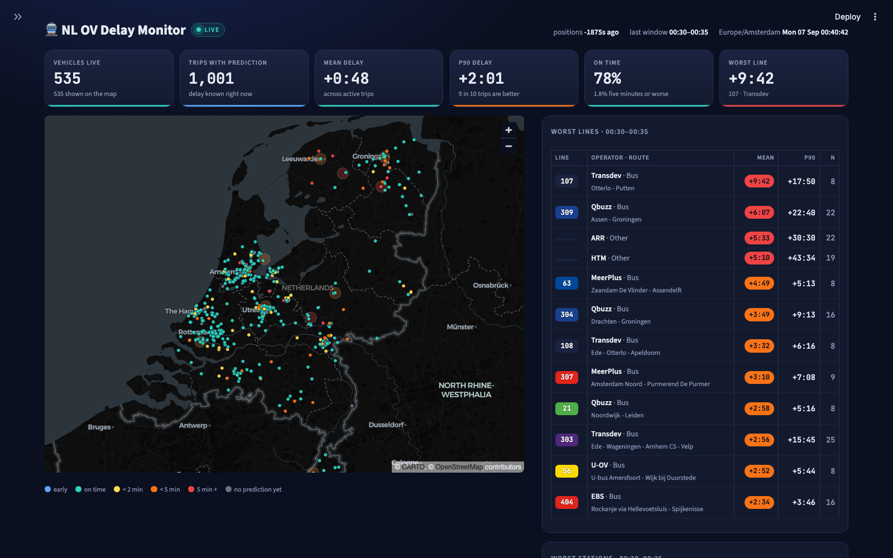
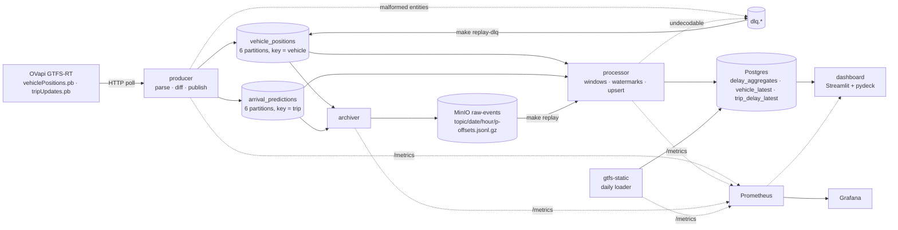

# Real-time NL OV Streaming Pipeline

    

Every vehicle in Dutch public transport, streamed live: OVapi's GTFS-realtime feeds go through
Kafka (Redpanda), a windowed stream processor computes exact 5-minute delay aggregates per line,
station, operator and network, Postgres serves them, and a live dashboard draws the whole country.



*Sunday 00:40, 535 vehicles on the road. Colour = current delay of the trip. Right: worst lines in
the last finalized window, with GTFS route colours.*

---

## What it does

| Stage | Component | What happens |
|---|---|---|
| Ingest | `producer/` | Polls `vehiclePositions.pb` (20 s) and `tripUpdates.pb` (60 s), parses GTFS-RT protobuf into a **versioned event contract**, diffs each full snapshot against the previous one and publishes only changes (plus a heartbeat) to `vehicle_positions` / `arrival_predictions`. Malformed entities go to `dlq.<topic>` with error headers. |
| Archive | `archiver/` | Own consumer group. Raw bytes to MinIO as gzipped JSON-lines, partitioned `topic/date/hour`, file names carry exact offset ranges. Commits only after a successful put. |
| Reference data | `gtfs-static/` | Streams the 220 MB static GTFS zip straight into `COPY`, loads agencies/routes/stops/trips into staging tables and swaps them in atomically. Refreshes daily. |
| Process | `processor/` | Manual-commit consumer. 5-minute **tumbling windows** (count, mean, P90, max, min) keyed by line, station, operator and network, **per-partition watermarks** with 2 min allowed lateness, in-window dedupe, **idempotent upserts** into Postgres, offsets committed only after finalized windows are written. Undecodable messages go to the DLQ. |
| Serve | `dashboard/` | Streamlit page: live map (pydeck on a Carto dark basemap), KPI tiles from the per-trip state, worst lines/stations from the last window, network trend, per-operator bars, delay distribution, pipeline health strip from Prometheus. Auto-refreshes every 10 s. |
| Observe | `observability/` | Prometheus scrapes every service and Redpanda; Grafana ships a provisioned 26-panel dashboard: throughput, consumer lag, watermark lag, DLQ rate, late events, processing time, state size, archive volume. |
| Replay | `ov-replay` | `make replay FROM= TO=` recomputes windows from the MinIO archive through the *same* pipeline code; `make replay-dlq` re-decodes dead letters with the current parser and re-injects the fixable ones. |

## Architecture



## Quick start

Prerequisites: Docker Desktop (or compatible), `make`, and [uv](https://docs.astral.sh/uv/) for
the local test suite. No accounts, no keys: OVapi is open access.

```bash
make up          # builds the images, starts 13 containers, waits until everything is healthy
make open        # http://localhost:8501
```

| URL | What | Login |
|---|---|---|
| http://localhost:8501 | Live delay dashboard | — |
| http://localhost:3000 | Grafana, dashboard *OV streaming pipeline* | anonymous viewer, `admin`/`admin` to edit |
| http://localhost:8080 | Redpanda Console: topics, consumer groups, messages | — |
| http://localhost:9011 | MinIO console: the raw archive | `minioadmin`/`minioadmin` |
| http://localhost:9090 | Prometheus | — |

What to expect after `make up`:

1. Within a minute: messages on both topics (Console), vehicles on the map with grey dots.
2. After ~2 min: the static GTFS load finishes (864k trips, 76k stops); dots get line names and
   the map tooltips fill in. Trip delays appear as soon as the processor has seen the first
   trip-update poll.
3. After ~7 min: the first 5-minute window finalizes (5 min window + 2 min allowed lateness);
   worst lines/stations tables and the trend chart populate.

Host ports 5433 (Postgres) and 9010/9011 (MinIO) were chosen to avoid the usual suspects;
override them in `.env`. Everything else is in `.env.example`, which `make up` copies to `.env`.

```bash
make test               # 101 unit tests: parsing on recorded fixtures, windows, sink, differ, ... (no broker needed)
make test-integration   # duplicate-delivery test and query tests against the running stack
make inject-bad         # publish two poison messages -> watch them land in the DLQ
make dlq-peek           # newest dead letters with their error headers
make replay-dlq ARGS=--dry-run
make replay FROM=2026-09-06T20:00 TO=2026-09-06T21:00
make throughput         # the numbers below, straight from Prometheus
make keep-awake         # macOS: a laptop that sleeps produces a very quiet 24-hour run
```

## The numbers

Measured on a 2019 Intel MacBook Pro running the whole stack in Docker Desktop, nationwide feed,
no operator filter. `make throughput` prints the table for any range (`RANGE=24h make throughput`).

| Feed facts (measured 2026-09-06/07) | |
|---|---|
| Vehicles in `vehiclePositions.pb` | ~1 400 late evening, ~4 900 in the morning peak |
| Trip updates in `tripUpdates.pb` | ~6 700 evening, ~17 000 morning peak; ~18 % of them cancelled/all stops skipped |
| Feed regeneration | both files change about once per **minute** (`Last-Modified` steps by 60 s) |
| Conditional GET | not honoured (always 200); polling faster than ~10 s earns an HTTP 429 |
| Reference join rate | 99 % of live trip ids, route ids and stop ids resolve against static GTFS |

| Pipeline (evening → morning) | |
|---|---|
| Messages in, sustained | 50–110 msg/s (positions ≈ 1 change per vehicle per minute; predictions heartbeat every minute) |
| Messages in, peak | 178 msg/s (a fresh snapshot after a poll gap) |
| Snapshot differ | suppresses 30–95 % of feed entities depending on how fast vehicles report |
| Windows finalized | ~220 per 5 minutes evening (line + station + operator + network), ~1 500 in the peak |
| Consumer lag | 0–200 messages in steady state; a 40-minute backlog was replayed at 1 400 msg/s |
| Watermark lag (now − event-time watermark) | ~175 s steady: 120 s allowed lateness + ~60 s feed cadence |
| Batch processing p95 | 0.23 s for a 2 000-message poll batch, including the state-table upserts |
| Window upsert p95 | 0.24 s for a batch of ~500 finalized windows |
| Late events dropped | 0 in steady state (see the watermark section for the catch-up story) |
| Raw archive | ~1 MB gzipped per hour at night; ~10 MB/h in the peak |

### The 24-hour run

The Definition of Done asks for a 24-hour continuous run with an annotated Grafana screenshot.
The stack has been running continuously since 2026-09-06 21:30 UTC; the annotated screenshot
lands here once the run is complete. Two things learned so far belong in the annotation:

* **The overnight lull is real**: between 01:00 and 05:00 Europe/Amsterdam there are 20–30 night
  buses in the whole country. Throughput drops to 2 msg/s, windows shrink to a handful of lines,
  and the dashboard says so honestly ("22 vehicles live") rather than faking motion.
* **A sleeping laptop is not a pipeline outage** — but it looks like one. macOS "maintenance
  sleep" pauses Docker and wakes for 45 s every hour; the effect is one tall window per hour and a
  30-minute watermark lag. `make keep-awake` (caffeinate) is now part of the runbook.

## Correctness: the parts an interviewer asks about

### At-least-once, made safe by idempotency

From `processor/src/processor/sink.py`, verbatim:

> The consumer commits Kafka offsets only *after* a finalized window has been upserted. If the
> process dies between the upsert and the commit, the broker redelivers the messages; the
> processor recomputes the window and upserts it again. The upsert key is
> `(window_start, dimension, dimension_id)` — the primary key of `delay_aggregates` — so the
> second write replaces the row with identical values instead of adding to it. Redelivery can
> therefore never double-count a finalized window. The "latest state" tables are guarded by
> `observed_at` so an older redelivered position can never overwrite a newer one.

Two details make this airtight rather than approximately right:

* **Offsets never run ahead of open windows.** Per partition the processor keeps consumed
  `(offset, window_end)` pairs in arrival order and commits one past the longest prefix whose
  windows are finalized. Everything in an open window is redelivered after a crash and rebuilds
  that window from scratch (`processor/consumer.py`, `_PartitionLedger`).
* **The watermark is seeded from Postgres on start-up** (`max(window_end)`), so redelivered
  messages that belong to windows already written are treated as late and dropped, instead of
  recomputing a *partial* window and overwriting a complete row.

`processor/tests/test_processor_sink.py::test_duplicate_delivery_does_not_double_count_in_real_postgres`
applies the same finalized window twice against the real database and asserts one row with the
original count. Exactly-once *delivery* is deliberately not attempted (PRD non-goal): this is the
cheaper guarantee that gives the same answer.

### Windows, watermarks and lateness

* Tumbling 5-minute windows aligned to the epoch; an event on the boundary belongs to the window
  that starts there.
* **Watermark = min over active partitions of (max event time seen) − 120 s.** The first
  version used a single global maximum; during a 40-minute catch-up the six partitions were
  consumed at different speeds and 169 000 perfectly good events were declared late. Per-partition
  watermarks (what Flink does) fixed it; a partition silent for 120 s stops holding the watermark
  back (Flink's idleness timeout), so a quiet partition cannot stall the pipeline.
* Events behind the watermark are **counted and dropped** — bounded state and one emission per
  window, in exchange for ignoring anything more than 2 minutes behind the stream. Late-event
  rate is a Grafana panel; in steady state it is zero because event time is the feed's own
  generation time, which is monotonic.
* When the stream goes quiet (idle 90 s) the processor advances the watermark by wall clock so
  the last window still closes at 03:00.
* P90 is exact (nearest-rank on sorted values). A few thousand observations per window per key
  makes that free and reproducible in a hand-computed test
  (`test_processor_aggregates.py::test_hand_computed_window_for_line_ns_ic_800`). At real scale
  this is the piece to swap for a t-digest; the accumulator interface would not change.

### Schema evolution

From `common/src/common/events.py`:

> `SCHEMA_VERSION` is stamped into every message body *and* into a Kafka header, so consumers can
> route on version without parsing the body. Backward-compatible changes (adding an optional field
> with a default) do not bump the version. Removing/renaming a field or changing a type does.
> `common.serde` keeps a decoder per supported version; the processor accepts the current and the
> previous version, so producers and consumers can be rolled independently.

A v2 rollout, concretely: add `_decode_v2` to `serde.DECODERS` and deploy the processor (it now
reads v1 and v2); deploy the producer writing v2; after the topic retention (24 h) has passed with
no v1 in flight, delete `_decode_v1`. Unknown versions are a `SchemaError`, which means the DLQ,
never a crash. The raw archive stores bytes, not events, so a new decoder can always be replayed
over history.

### Dead letters and replay

* Policy: anything that fails parsing (producer) or decoding (processor) goes to `dlq.<source_topic>`
  as the **original bytes**, with headers `stage`, `source_topic`, `source_partition`,
  `source_offset`, `error`, `failed_at`, `schema_version`. The main loop never blocks on it.
* Parse errors repeat on every snapshot (the feed re-sends the same broken entity every minute),
  so the producer dead-letters each distinct `(entity, reason)` once. Real examples from the feed:
  vehicles without a position, without a trip id, with coordinates at (0, 0).
* `make inject-bad` publishes two poison messages; they show up in `make dlq-peek`, on the
  Grafana DLQ panel and in the dashboard's health strip within 10 s.
* `make replay-dlq` re-runs the failed step with the current code (a parser fix, a new schema
  version) and re-injects successes into the source topic with a `replayed_from` header; the
  still-failing ones stay put and are summarised by reason.
* `make replay FROM=… TO=…` re-processes raw archive files for a range through the identical
  `Pipeline` class the consumer uses — replay is not a second implementation — deduplicating by
  `(topic, partition, offset)`.

## Data source quirks worth knowing

Everything below was discovered from the live feed and shaped the code; the recorded responses in
`producer/tests/fixtures/gtfsrt/` (with `record.sh`) pin the tests to reality.

* Entity ids look like `2026-09-06:GVB:13:13605` = `date:operator:line:journey`; the operator code
  exists nowhere else, so it is parsed from the id.
* `VehiclePosition` carries **no delay**; delay lives in `TripUpdate.stop_time_update[].
  departure/arrival.delay`. One prediction event per trip is emitted for its *next* stop — the
  trip's current delay — and feeds four window dimensions at once.
* Both feeds are `FULL_DATASET` snapshots and regenerate once a minute. Publishing them verbatim
  would be 700 msg/s of repeats; the snapshot differ turns them into change events plus a
  60-second heartbeat so a trip stuck at +5:00 still counts in every window.
* Trips that start tomorrow morning are in the feed all day, "on time". Predictions whose next stop
  is more than 15 minutes out are skipped.
* Ghost vehicles: some positions are hours or days old (a bus "STOPPED_AT" the same spot for
  eleven days), and one vehicle reported from 29 minutes in the future. Positions older than 10
  minutes or more than a minute ahead of the feed are dropped.
* OVapi rate-limits (HTTP 429) and ignores `If-None-Match`. The producer backs off on 429
  (Retry-After or exponential up to 5 min) and polls at 20 s / 60 s.
* ~1 % of route ids in the realtime feed are missing from the static GTFS; the dashboard shows
  the operator and falls back to the raw id.

## Decisions and trade-offs

| Decision | Alternative | Why |
|---|---|---|
| OVapi GTFS-RT over HTTP | NDOV KV6 over ZeroMQ (gzipped XML) | Protobuf with an official spec and library; the adapter is one module (`producer/parse.py`) so the swap is contained |
| Delay = feed-provided field | predicted − scheduled | It is what the operator publishes; computing it needs `stop_times.txt` (1 GB) |
| Fixtures in the repo, no sample archive | 24 h of raw data in git | 140 KB of recorded protobuf pins every parser test; the archive is reproducible |
| Nationwide, no operator filter | trains + a few bus operators | A laptop handles ~110 msg/s in Python with headroom; `OPERATOR_FILTER` remains a one-line config |
| Snapshot diff + heartbeat in the producer | publish every snapshot | 5–20× fewer messages with identical window statistics |
| Keys: `vehicle_id` / `trip_id` | round-robin | Per-key ordering on one partition is what makes last-write-wins state and dedupe reason about time |
| Pure-Python windowing engine, no Kafka imports | window inside the consumer loop | Deterministic tests with synthetic sequences; the same engine runs replay |
| Per-partition watermarks, 2 min lateness, drop late | global watermark; keep late events | Global watermark marked 169 k events late during catch-up; keeping late events means unbounded state or re-emitting windows |
| Offsets commit after upsert; upsert key = window key | auto-commit; exactly-once transactions | At-least-once plus idempotency gives the same answer with none of the transactional plumbing |
| Extra `operator` and `network` dimensions | derive from line aggregates | Network P90 cannot be derived from per-line P90s; four dimensions cost one dict insert each |
| Exact P90 | t-digest | Reproducible in a hand-computed test; swap point documented |
| Idle-time watermark advance (90 s) | pure event time | Otherwise the last window of the night never closes |
| Python consumer, not Spark Structured Streaming | PySpark | The simplest thing that demonstrates windowing correctly; the swap is a documented migration, not a prerequisite |
| Static GTFS via `COPY` + atomic table swap, daily `sleep` loop | Airflow | A cron sidecar, not an orchestrator; readers never see a half-loaded set |
| Streamlit + pydeck | React + deck.gl | The pipeline is the product; still, the page is styled to be watched |
| One parametrised Dockerfile for five services | five Dockerfiles | One dependency layer, cached across services |
| Everything in docker-compose | cloud | PRD non-goal; zero cost, `make up` is the whole deployment |

## Repository layout

```
ov-streaming-pipeline/
├── common/          event contract (events.py), serde with versioned decoders, config, metrics
├── producer/        feed client, GTFS-RT parser, snapshot differ, Kafka publisher, recorded fixtures
├── archiver/        raw messages -> MinIO, offset-range file names
├── gtfs-static/     static GTFS -> Postgres reference tables (staging + atomic swap)
├── processor/       windows.py (engine), aggregates.py, pipeline.py, consumer.py, sink.py, dlq.py, replay.py
├── dashboard/       Streamlit app, queries, theme, stylesheet
├── observability/   prometheus.yml, Grafana provisioning, build_dashboard.py -> dashboards/pipeline.json
├── infra/           docker/service.Dockerfile, init/create_topics.sh, init/postgres/01_schema.sql
├── scripts/         throughput.py (README numbers from Prometheus), dlq_peek.py
├── docker-compose.yml · Makefile · pyproject.toml (uv workspace) · PRD.md
└── .github/workflows/ci.yml   lint + unit tests; integration tests stay local (PRD N3)
```

## Testing

* `make test` — 101 unit tests, no infrastructure: parser against recorded feeds (including a
  mixed-quality and a garbage fixture), serde round-trips and every `SchemaError` path, the
  snapshot differ, window assignment / lateness / duplicates / per-partition watermarks, the
  hand-computed window, sink idempotency with a recording fake, DLQ headers, the offset ledger,
  the dashboard's formatting and SQL invariants.
* `make test-integration` — against the running stack: the duplicate-delivery test on real
  Postgres, the static GTFS loader's atomic swap, the dashboard queries.
* `make lint` — ruff, line length 100, imports sorted, no `# noqa` sprawl.

## Not done yet

* The annotated 24-hour Grafana screenshot and the 2-minute screen recording (the run is in
  progress; both are recording tasks, not code).
* PySpark Structured Streaming swap (stretch, only if genuinely ahead).
* KV6/ZeroMQ adapter as an alternative feed.

## Skills demonstrated

Kafka (Redpanda) · event-driven design · stream windowing and watermarks · at-least-once with
idempotent sinks · dead-letter queues and replay · schema evolution · Python 3.12 · Postgres ·
Docker Compose · Prometheus/Grafana · Streamlit/pydeck · uv workspaces · ruff/pytest
